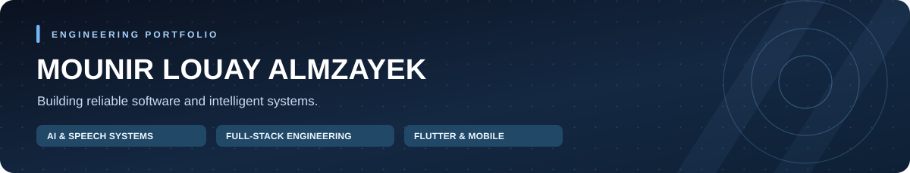

  

<strong>Software Engineer · AI &amp; Speech Systems · Full-Stack · Flutter</strong>

I build reliable mobile products, backend platforms and applied AI systems—with attention to architecture, offline resilience and engineering trade-offs.

  <a href="https://www.linkedin.com/in/mounir-almzayek-baba06279/">LinkedIn</a> &nbsp;·&nbsp;
  <a href="mailto:mouneeralmzayek@gmail.com">Email</a> &nbsp;·&nbsp;
  <a href="https://www.byliqaa.me/ar">Liqaa (live product)</a> &nbsp;·&nbsp;
  <a href="https://github.com/Mounir-Almzayek?tab=repositories">Repositories</a>

  <a href="#featured-work">Featured projects</a> &nbsp;·&nbsp;
  <a href="#engineering-approach">Engineering approach</a> &nbsp;·&nbsp;
  <a href="#public-project-index">Project index</a> &nbsp;·&nbsp;
  <a href="#experience">Experience</a> &nbsp;·&nbsp;
  <a href="#certifications">Certifications</a>

---

## A quick technical overview

| Engineering track | What I work on | Start with |
|---|---|---|
| **AI, agents & speech** | LLM orchestration, RAG, model adaptation, speech pipelines, tool policy | [RS4IT MCP Hub](https://github.com/Mounir-Almzayek/Rs4it-MCP) · [Resume Analyst](https://github.com/Mounir-Almzayek/CV-management) · [Whisper research](https://github.com/Mounir-Almzayek/quran-whisper-small-colab) |
| **Web, APIs & platforms** | React/Next.js, NestJS/Fastify, backend contracts, data access, admin systems | [Liqaa live product](https://www.byliqaa.me/ar) · Wusol · Tebyan |
| **Mobile & cross-platform** | Flutter/Dart, offline-first systems, device/payment integrations, Android/iOS/Windows | [Survey application](https://github.com/Mounir-Almzayek/survey-app) · [Bin Taleb on Play](https://play.google.com/store/apps/details?id=com.rs4it.bin_taleb) |

## Featured projects

A focused shortlist for technical reviewers: **what it does, the engineering involved, and evidence to explore**. Private team and client code is not linked.

| Project | Engineering focus | Evidence |
|---|---|---|
| **Tebyan — mosque platform & live recitation** | Flutter mobile/display with offline-first behavior; FastAPI/WebSocket live imam tracking via speech recognition and constrained Quran alignment. | Team source private |
| **M.O.U.N.I.R — personal AI agent** | Local-first agent architecture with durable identity, governed memory, bounded context and explicit action controls. | Private source |
| **Liqaa — digital invitations** | Interactive invitation templates, event details and RSVP workflows built for the web. | [Live product](https://www.byliqaa.me/ar) |
| **Wusol — school management SaaS** | Next.js, TypeScript, Fastify, Prisma and MySQL; multi-tenant administration and role-based access. | Private source |
| **King Abdulaziz Center Survey** | Flutter/BLoC offline-first survey collection with GPS, QR device custody and background synchronization. | [GitHub](https://github.com/Mounir-Almzayek/survey-app) |
| **RS4IT MCP Hub** | Next.js administration, role visibility, integrated tools and MCP service interfaces. | [GitHub](https://github.com/Mounir-Almzayek/Rs4it-MCP) |
| **Mazed — POS & accounting integration** | Flutter Windows/mobile, NamiPay payment terminals, ERP integrations and transaction reliability. | Employer source private |
| **Resume Analyst AI** | FastAPI, MongoDB and embeddings for CV extraction, hybrid search and job matching. | [GitHub](https://github.com/Mounir-Almzayek/CV-management) |

<strong>More products, applied AI and research</strong> — 7 highlights

| Project | Focus & public link |
|---|---|
| **OVA — real-estate AI assistant** | Assistant quality and valuation workflows at Ovaluate (private company source). |
| **The Saudi Cup** | Event guest services · [Google Play](https://play.google.com/store/apps/details?id=com.app.saudicup) |
| **The Swimmer ecosystem** | Customer and maintenance apps · [Google Play](https://play.google.com/store/apps/details?id=com.rs4it.swimmer) |
| **Bin Taleb** | Pool products and services · [Google Play](https://play.google.com/store/apps/details?id=com.rs4it.bin_taleb) |
| **Advanced Neural Network Framework** | From-scratch NumPy layers, optimizers and training · [GitHub](https://github.com/Mounir-Almzayek/Simple-Neural-Network) |
| **Quran ASR experiments** | Whisper Tiny/Small and NeMo FastConformer for Quran speech adaptation · [Tiny](https://github.com/Mounir-Almzayek/quran-whisper-tiny-colab) · [Small](https://github.com/Mounir-Almzayek/quran-whisper-small-colab) · [FastConformer](https://github.com/Mounir-Almzayek/quran-fastconformer-colab) |
| **AutoContent AI** | Agentic editorial workflow integrating FastAPI, LangGraph and WordPress · [GitHub](https://github.com/Mounir-Almzayek/AutoContent-AI) |

## How I engineer systems

Rather than listing every library I have touched, these are the practices I try to make visible in the code:

- **Explicit architecture:** domain/application/data boundaries, typed contracts, dependency isolation and maintainable feature modules.
- **Reliability under failure:** offline-first clients, local persistence, synchronization, idempotency, retry controls and safe fallbacks.
- **Security by design:** role-based authorization, validation, secret boundaries and policy-gated AI actions.
- **Measured AI work:** held-out datasets, reproducible manifests, model/version separation and evaluation beyond training loss.
- **Engineering delivery:** Git-based collaboration, CI checks, automated tests, Dockerized services, platform-specific integrations and clear handover documentation.

| Area | Core toolkit |
|---|---|
| **Mobile** | Flutter, Dart, BLoC/Cubit, Kotlin, Swift, SQLite, Hive, Firebase/FCM |
| **Web & backend** | TypeScript, React, Next.js, NestJS, Fastify, Python, FastAPI, REST APIs |
| **AI & speech** | PyTorch, TensorFlow, scikit-learn, NumPy, LangChain, LangGraph, MCP, RAG, Whisper, NeMo |
| **Data & operations** | PostgreSQL, MySQL, MongoDB, Redis, Supabase, Docker, GitHub Actions, Cloudflare |

## Public project index

All **26 public repositories other than this profile README**, grouped to keep the front page readable. The index includes earlier learning projects and prototypes; their presence does not imply each is a deployed product. Some older Flutter repositories still need project-specific documentation.

<strong>AI, speech & intelligent systems</strong> — 10 repositories

| Repository | Focus |
|---|---|
| [RS4IT MCP Hub](https://github.com/Mounir-Almzayek/Rs4it-MCP) | MCP-compatible tool hub with roles, admin UI, and service integration. |
| [Resume Analyst AI](https://github.com/Mounir-Almzayek/CV-management) | FastAPI CV ingestion, semantic matching, and MongoDB search. |
| [Advanced Neural Network Framework](https://github.com/Mounir-Almzayek/Simple-Neural-Network) | Neural layers, optimizers, training, and tuning built with NumPy. |
| [Quran Whisper Small](https://github.com/Mounir-Almzayek/quran-whisper-small-colab) | LoRA ASR adaptation experiment with reciter-disjoint evaluation. |
| [Quran Whisper Tiny](https://github.com/Mounir-Almzayek/quran-whisper-tiny-colab) | Full fine-tuning experiment with WER/CER and validation safeguards. |
| [Quran FastConformer](https://github.com/Mounir-Almzayek/quran-fastconformer-colab) | NeMo-based Arabic Quran ASR adaptation and guarded evaluation. |
| [Adaptive Agentic RAG](https://github.com/Mounir-Almzayek/Adaptive-Agentic-RAG-System) | Adaptive/hybrid retrieval, conversational memory, and tool workflows. |
| [Autonomous Deterministic Agent System](https://github.com/Mounir-Almzayek/autonomous-deterministic-agent-system) | Policy-gated, risk-scored, auditable AI action decisions. |
| [AutoContent AI](https://github.com/Mounir-Almzayek/AutoContent-AI) | Multi-agent editorial workflow integrated with WordPress. |
| [OpenRouter FastAPI Template](https://github.com/Mounir-Almzayek/Open-Router) | Multi-provider LLM integration, tool calling, caching, and fallbacks. |

<strong>Mobile applications & interactive products</strong> — 10 repositories

| Repository | Focus |
|---|---|
| [King Abdulaziz Center Survey](https://github.com/Mounir-Almzayek/survey-app) | Offline-first survey collection, syncing, custody and GPS. |
| [Visitors Management](https://github.com/Mounir-Almzayek/visitors) | Attendance flows with QR, localization and authentication. |
| [Clinic Hub](https://github.com/Mounir-Almzayek/Clinic-Hub) | Healthcare-oriented Flutter application. |
| [Zaker](https://github.com/Mounir-Almzayek/Zaker-App) | Flutter exam-preparation and practice application. |
| [Sold Out / Order Application](https://github.com/Mounir-Almzayek/Order-Application-) | Delivery and order tracking with maps and localization. |
| [Wasfeh](https://github.com/Mounir-Almzayek/Wasfeh) | Digital-prescription workflow using QR and app notifications. |
| [CIMT Arm](https://github.com/Mounir-Almzayek/cimt-arm) | Flutter rehabilitation application codebase. |
| [Clothing Game](https://github.com/Mounir-Almzayek/Clothing-Game) | Interactive Flutter educational game. |
| [Minesweeper](https://github.com/Mounir-Almzayek/Minesweeper) | Flutter game with classic game logic. |
| [Connect Four](https://github.com/Mounir-Almzayek/Connect-Four) | Board-game project with algorithmic opponent. |

<strong>Backend, computer science & coursework</strong> — 5 repositories

| Repository | Focus |
|---|---|
| [High-Performance E-Commerce Backend Engine](https://github.com/Mounir-Almzayek/High-Performance-E-Commerce-Backend-Engine) | Django/DRF coursework exploring transactions, concurrency and load testing. |
| [SQL Compiler](https://github.com/Mounir-Almzayek/SQL-Compiler) | Java/ANTLR4 lexer, parser and AST construction. |
| [Cinema Booking System](https://github.com/Mounir-Almzayek/Cinema_Java_Swing_Project) | Java Swing desktop coursework. |
| [Trees & Graphs in Java](https://github.com/Mounir-Almzayek/Trees-and-Graphs-in-Java) | Data-structure and graph algorithm implementations. |
| [Tree Representations](https://github.com/Mounir-Almzayek/Tree-representations-and-dealing-with-papers) | Academic work on tree representations and related algorithms. |

<strong>Portfolio infrastructure</strong> — 1 repositories

| Repository | Focus |
|---|---|
| [Portfolio Site Repository](https://github.com/Mounir-Almzayek/Mounir-Almzayek.github.io) | Source repository for personal web presence. |

## Professional experience

| Period | Role | Organization | Engineering emphasis |
|---|---|---|---|
| **Sep 2026 – present** | Flutter Software Engineer | **Aram Tech** | Mazed POS, ERP/payment integrations, Windows and mobile |
| **May – Jun 2026** | Generative AI Engineer | **Ovaluate** | OVA assistant quality, conversational behavior and valuation workflows |
| **Nov 2025 – May 2026** | AI Engineer | **RS4IT — Realistic Solutions for IT** | AI agents, RAG, Python/FastAPI and business automation |
| **Aug 2025 – May 2026** | Lead Flutter Developer | **RS4IT — Realistic Solutions for IT** | Mobile-team leadership, production Flutter delivery, offline-first design |
| **Oct 2024 – Apr 2025** | Mobile Development Intern | **Misbar** | Flutter development, GetX, code review and mobile app delivery |
| **Aug 2025** | AI with Coding & Cybersecurity Intern / Bootcamp | **EARTech IT** | Applied ML, software development, cybersecurity and collaborative tooling |

**Education:** Informatics Engineering — Artificial Intelligence specialization, University of Damascus.

## Certifications

**DeepLearning.AI / Coursera**

- Neural Networks and Deep Learning (Feb 2026)
- Machine Learning
- Unsupervised Learning, Recommenders, Reinforcement Learning (Feb 2026)
- Retrieval Augmented Generation (RAG) (Feb 2026)
- Advanced Learning Algorithms (Dec 2025)
- Supervised Machine Learning: Regression and Classification (Nov 2025)
- AI For Everyone (Oct 2025)

**Additional training:** EARTech IT — AI with Coding & Cybersecurity Bootcamp.

**Languages:** Arabic (native) · English (professional working proficiency).

---

## Let's connect

Interested in **mobile architecture**, **backend platforms**, **AI agents**, or **speech systems**? I enjoy discussing real constraints, maintainable solutions and the trade-offs behind engineering decisions.

**[LinkedIn](https://www.linkedin.com/in/mounir-almzayek-baba06279/)** · **[Email](mailto:mouneeralmzayek@gmail.com)** · **[GitHub repositories](https://github.com/Mounir-Almzayek?tab=repositories)**

Professional portfolio · Selected project descriptions are drawn from public repositories and professional project information. Private client/team source code is intentionally not linked. Last curated: November 2026.
